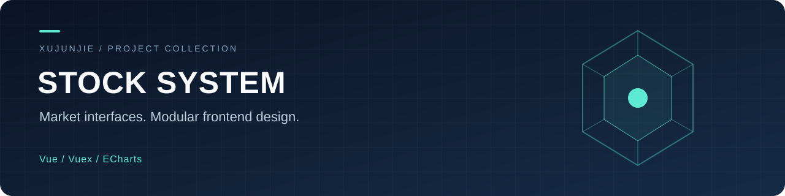

# Stock System · 股票行情与模拟交易前端
> 使用模块化前端结构展示行情查询、模拟交易与分析交互。

**Vue 2 · Element UI · Vuex · Vue Router · ECharts · Mock.js**

## 项目概览

本仓库是以股票业务场景为载体的前端练习项目，包含行情、自选、交易记录和分析报告等页面。数据演示依赖 Mock，适合展示组件拆分、模块化状态管理和图表交互。

## 功能与代码入口

| 模块 | 内容 | 代码入口 |
| --- | --- | --- |
| 行情 | 行情列表、筛选、详情与 K 线 | [行情页面](src/views/quote/) |
| 模拟交易 | 委托、持仓、记录与复盘 | [交易组件](src/components/trade/) |
| 分析展示 | 策略选择、评分、预测与回测结果组件 | [分析组件](src/components/ai/) |
| 个人中心 | 自选管理、设置与帮助 | [个人页面](src/views/mine/) |

## 实现亮点

- **按业务分层**：API、Vuex 状态、页面和组件分别维护，便于沿单个业务模块阅读。
- **独立状态模块**：[store/modules](src/store/modules/) 分离行情、交易、用户与分析状态。
- **图表与表单组合**：K 线、复盘图与委托表单围绕业务页面组合。
- **交互基础设施**：[自定义指令](src/directives/)与 [mixins](src/mixins/) 收纳长按、尺寸监听、刷新等公共逻辑。
- **可替换数据层**：[src/mock/](src/mock/) 和 [src/api/](src/api/) 分离演示数据与请求入口。

## 运行与构建

依赖版本以 [package.json](package.json) 与锁文件为准。在兼容 Vue CLI 4 的 Node.js 环境中准备好原项目依赖后：

```bash
npm run dev
npm run build
```

开发地址以终端输出为准。本项目没有 `serve` 或 `lint` 脚本。

## 数据边界

[src/main.js](src/main.js) 当前包含无条件 Mock 导入，因此不能把页面中的行情、交易或分析结果当作真实市场结果。生产构建也需要单独处理数据源切换。仓库未包含真实交易后端或可验证的预测模型。

## 阅读顺序

先看 [路由](src/router/routes.js)，再选择一个页面，沿“页面 → Vuex → API → Mock”阅读数据流。讲解时可重点展示委托表单、持仓列表和交易复盘的组件关系。

## 许可证

仓库根目录尚无项目许可证。引用、分发和部署前需核实原创代码与第三方依赖的授权。
